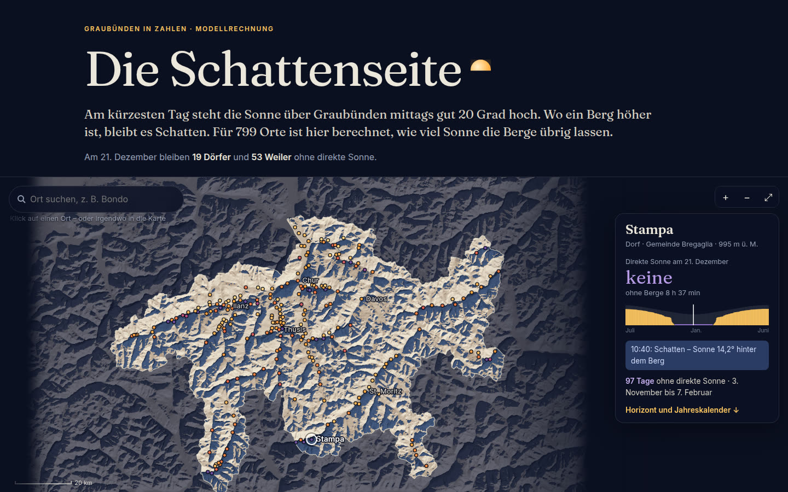
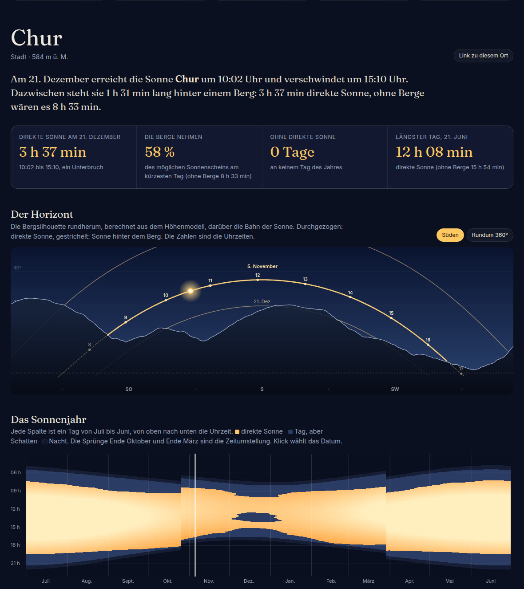
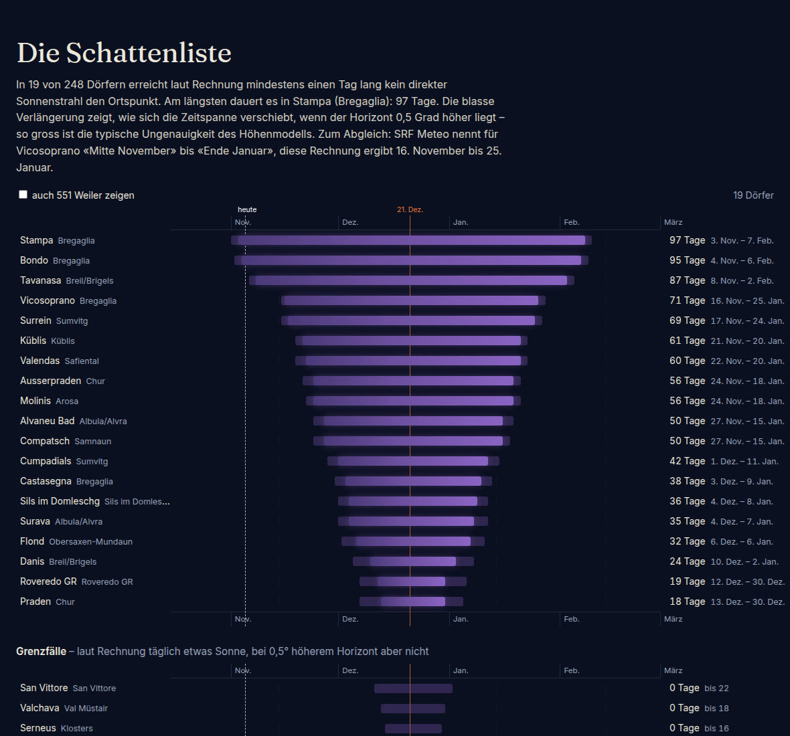
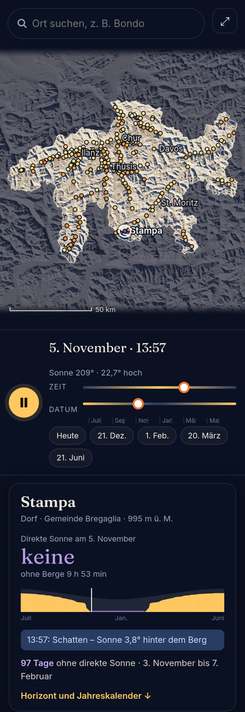

# Guten Morgen, Julian

> **Historisch – Übergabe vom 5.11.2026 früh.** Seither: live auf GitHub Pages, schneller, mobil überarbeitet,
> Server-Festplatte aufgeräumt. Aktueller Stand und Einstieg: [`README.md`](README.md).

## In drei Sätzen

Ich habe **«Die Schattenseite»** gebaut: eine interaktive Datengeschichte, die für 799 Bündner Orte
aus einem offenen Höhenmodell den Gebirgshorizont berechnet und darüber die Sonnenbahn jedes Tages legt.
Daraus entstehen Zahlen, die es so nirgends als Statistik gibt: Minuten direkter Sonne am 21. Dezember,
Tage ganz ohne Sonne, Datum der Rückkehr – plus eine Karte, auf der die echten Schatten der Berge in
Echtzeit über den Kanton wandern, und ein Klick auf jeden beliebigen Punkt ergibt einen persönlichen
Sonnenkalender. Die Rechnung trifft den einzigen öffentlichen Vergleichswert, den ich fand: SRF Meteo
nennt für Vicosoprano «Mitte November bis Ende Januar», das Modell 16. November bis 25. Januar.



## Starten

- **Einfachste Variante:** `schattenseite/index.html` doppelklicken (läuft auch von der Festplatte, ohne Server, ohne Internet).
- Oder lokal: `cd schattenseite && python3 -m http.server 8000` → http://localhost:8000
- **Nichts ist gepusht oder veröffentlicht.** Alles liegt in 7 lokalen Commits auf `gh-pages` (ab `f1672bd`).
  Ein `git push` würde die Seite unter `…github.io/claude_code_git_workspace/schattenseite/` live schalten – das entscheidest du.
- Einbetten im CMS (iframe): `index.html?embed=karte` (nur Karte) oder `index.html?embed=ort#ort=1577255384-chur` (nur Ortsteil).
  Jeder Ort hat einen eigenen Link (Knopf «Link zu diesem Ort»), auch beliebige Kartenpunkte (`#punkt=46.6,9.3`).

## Was drin ist

| Teil | Was es zeigt |
|---|---|
| Karte | Relief mit live berechneten Schlagschatten; Regler für Uhrzeit und Datum, Play-Knopf spielt den Tag ab. Punkte = Sonnenminuten des gewählten Tages. Klick irgendwo = Rechnung für diesen Punkt (im Browser, ~0,4 s) |
| Ortskarte | Sonne heute, Jetzt-Zustand («Schatten – Sonne 9,3° hinter dem Berg»), Mini-Jahreskurve |
| Entdeckungen | 5 Einstiege, alle aus den Daten berechnet, das erste ändert sich mit dem Datum («Als Nächstes verschwindet die Sonne in Tavanasa, 8. November») |
| Horizont | 360°-Panorama mit Bergsilhouette, Sonnenbahnen 21.6./20.3./21.12. und gewählter Tag, Uhrzeiten |
| Sonnenjahr | Jeder Tag × jede Uhrzeit: Sonne / Schatten / Nacht – das «Loch» im Winter wird sichtbar |
| Schattenliste | 19 Dörfer (72 Orte mit Weilern) mit Schattenzeit als Zeitbalken, inkl. Unsicherheitsband |
| Methode | Quellen, Prüfungen, Grenzen – im Stück selbst |





## Befunde (Modellrechnung, zu verifizieren)

- **Stampa 97 Tage, Bondo 95, Tavanasa 87, Vicosoprano 71** ohne direkte Sonne (Spannweite bei ±0,5° Horizont z. B. Stampa 94–101).
- **Chur:** Am 21. Dezember verschwindet die Sonne über Mittag rund anderthalb Stunden hinter dem Berg im Süden (71–108 min je nach Toleranz; Horizont Süd gegen swisstopo-Profil geprüft: 18,6° vs. 18,1°). Gilt für den OSM-Punkt in der Altstadt.
- **Sonnigstes Dorf am 21.12.:** Seewis Dorf, 7 h 20 min (ohne Berge 8 h 32).
- 248 Dörfer und Städte, 551 Weiler; davon 19 bzw. 53 mit mindestens einem sonnenlosen Tag.

**Verifizieren, bevor publiziert wird:** Vor Ort / bei Gemeinden nachfragen (Bondo, Tavanasa, Küblis, Chur Altstadt).
Wichtig: Ein Ortspunkt ist der OSM-Dorfkern – am Hang 100 m weiter kann es Wochen Unterschied machen. Gute Leserfrage: «Stimmt das bei Ihnen?»

## Was gut funktioniert

- Rechnung geprüft: Sonnenstand vs. SunCalc ≤ 0,02°; Horizont vs. swisstopo-Profile (80 Stichproben) mittlere Abweichung 0,45°, Median 0,0°; Vicosoprano deckungsgleich mit SRF.
- Tests: `node _build/test_consistency.mjs` (Browser rechnet exakt wie die Vorberechnung) und `node _build/test_e2e.mjs` (18 Browser-Tests) – alle grün.
- Schnell: Schattenbild 43 ms auf dem Server; bei schwachen Geräten automatisch gröberes Gelände (30 ms auch bei 3-facher CPU-Drosselung). Mobil ohne horizontales Scrollen.
- Vier Kritikrunden in `KRITIK.md` dokumentiert (Runde 4 = Schlussabnahme).

## Was (noch) nicht gut ist

- **Datenmenge 3,2 MB** (Gelände 2,3 MB). Auf langsamen Mobilnetzen ein paar Sekunden Ladezeit.
- Copernicus ist ein **Oberflächenmodell**: grosse Wälder zählen als Berg (Abweichungen bei Arosa, Tschlin). Gebäude sind herausgefiltert, aber nicht perfekt.
- Kartenschatten sind Veranschaulichung (Sonnenstand der Kantonsmitte, 150-m-Gitter); massgebend sind die Ortszahlen.
- Weiler aus OSM sind uneinheitlich erfasst; Liste der Weiler deshalb nur auf Wunsch.
- Dunkles Design passt nicht automatisch ins helle Südostschweiz-Layout (als Embed ok, als eigene Seite am besten).
- Nicht auf echten Handys/Safari getestet, nur Headless-Chromium.

## Was ich als Nächstes machen würde

1. Vor Ort verifizieren (2–3 Gemeinden anrufen) und Ortspunkte der Top-10 prüfen.
2. Lesermeldungen: «Wann kommt bei Ihnen die Sonne zurück?» – Abgleich mit dem Modell als Folgestück.
3. Zum 21. Dezember publizieren; um Weihnachten/Neujahr Folge «Die Sonne kehrt zurück» (dynamische Entdeckungs-Kachel ist schon da).
4. Terra Grischuna: Reportage aus einem Schattendorf (Bondo/Stampa), Grafiken aus dem Tool als Bildmaterial.
5. Technisch: Gelände als Kacheln nachladen (schneller), swissALTI3D für die Nahzone.

## Verwenden, einsetzen, verkaufen (Vorschlag, nicht entschieden)

- **Südostschweiz:** Datenstory zur Wintersonnenwende + Embeds pro Dorf in Lokalartikeln; jedes Jahr wieder verwendbar (Sonnenbahn ist jedes Jahr fast gleich).
- **Lizenz an andere Regionalmedien** (Wallis, Tessin, Berner Oberland, Uri): Gleiches Skript, anderer Ausschnitt – die Rechenkette ist kantonsunabhängig. Annahme: Aufwand pro Region ½–1 Tag, weil nur Ortsliste und Ausschnitt ändern.
- **Gemeinden/Tourismus/Immobilien:** «Sonnenkalender für Ihre Adresse» – Sonnenstunden im Winter sind ein Wohnargument. Achtung: Es gibt kommerzielle Anbieter (solartopo.com, auf das sich SRF stützt; Shadowmap), d. h. der Wert liegt im journalistischen Kontext, nicht im Rechner allein.
- **KI-Officer-Showcase:** Beispiel, was eine Nacht Journalist + KI + offene Daten ergibt – mit nachvollziehbarer Prüfkette.
- Zahlen zu Marktgrösse/Preisen habe ich bewusst keine erfunden.

## Annahmen

- Annahme: Du willst es zuerst sehen – deshalb **nichts gepusht**, Commits nur lokal.
- Annahme: Copernicus GLO-30 darf mit Quellenangabe auch kommerziell verwendet werden (öffentliche GLO-30-Lizenz, Pflichttext ist im Stück) – vor Publikation kurz bestätigen.
- Annahme: OSM-Ortspunkte (ODbL) sind gute Stellvertreter für «das Dorf». Saison 1.7.2026–30.6.2027; Daten Stand 4.11.2026.
- Annahme: «Direkte Sonne» = Mitte der Sonnenscheibe über dem Gelände; Horizont bis 35 km, Nahbereich < 100 m ignoriert.
- Footer nennt «Konzept und Umsetzung: Julian Reich mit Claude (KI)» – Platzhalter, bitte anpassen.

## ⚠️ Wichtig, unabhängig vom Projekt: Server-Festplatte ist voll

Beim Start waren nur noch **~390 MB frei, jetzt ~20 MB** (Hauptverbraucher sind nicht meine Dateien:
`/tmp` 4,3 GB, `~/.cache` 2,5 GB, `~/.npm` 266 MB – davon rund 38 MB npm-Cache, den meine Installation heute Nacht angelegt hat). Deine Cronjobs für **staulage.ch** schreiben laufend Logs –
bei 0 MB können sie ausfallen. Ich habe ausserhalb dieses Ordners nichts gelöscht (ein Versuch, meinen eigenen
npm-Cache von heute Nacht zu leeren, wurde vom Sicherheitsfilter blockiert – richtig so). Bitte heute aufräumen,
z. B. `/tmp` prüfen. Meine eigenen Dateien: `schattenseite/_build/node_modules` (~19 MB) und `_build/cache` (~3 MB)
kannst du löschen; sie sind gitignored und mit `npm i` bzw. den Skripten wiederherstellbar.

## Neu rechnen

```
cd schattenseite/_build
npm i geotiff@2 suncalc playwright-core          # einmalig
sh fetch_osm.sh               # Orte + Grenzen aus OpenStreetMap (Overpass)
node fetch_heights.mjs        # Bodenhöhen swisstopo
node build_dem.mjs            # Höhenmodell + Horizonte (lädt ~150 MB übers Netz, schreibt nichts Grosses)
node build_stats.mjs          # Jahresstatistik → data/places.js (80 s)
node bundle.mjs               # js/*.js → js/bundle.js
node test_consistency.mjs && node test_e2e.mjs
```
